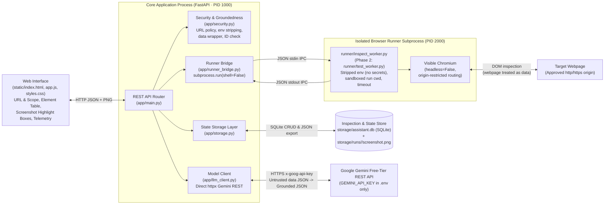
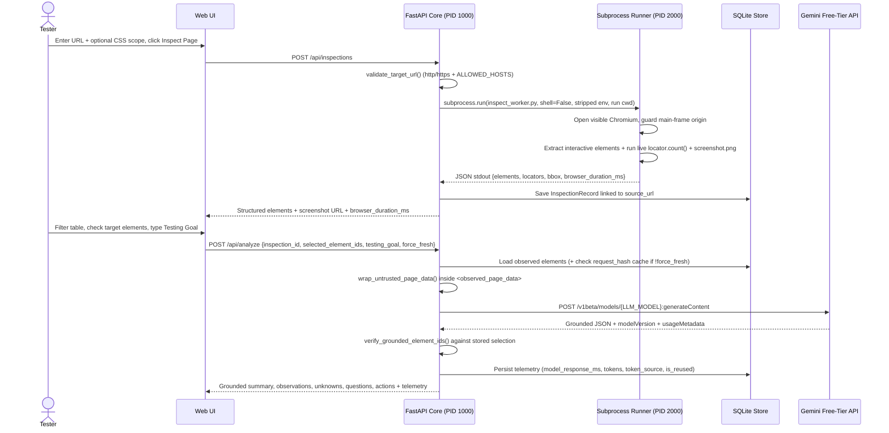
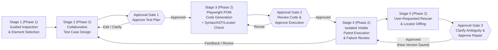

# Phase 1 System Design — Human-in-the-Loop Web Testing Assistant

**Course:** Generative AI for Software Testing  
**Submission:** Phase 1 — Architecture and Guided Inspection (Week 9)  
**Scope:** End-to-end architecture plan for Phases 1–2 + working Phase 1 guided inspection prototype.

---

## 1. System Overview & Core Design Principles

The assistant is designed as a **human-supervised five-stage pipeline** where deterministic browser automation gathers ground-truth facts from the DOM, the human tester stays in control of scope, requirements, and approvals, and a free-tier LLM reasons **strictly over observed evidence**:

1. **Ground outputs in observed evidence:** Interactive elements and candidate Playwright locators are extracted deterministically by Playwright (`runner/inspect_worker.py`) and verified live via `locator.count()` before the model ever sees them.
2. **Process isolation for browser automation & generated tests:** The core FastAPI application never imports Playwright directly and never executes generated tests in-process. All browser work runs inside a restricted child process with zero API keys and controlled filesystem/origin scope.
3. **Human-in-the-loop control:** The tester refines inspection scope, selects target elements, specifies testing goals, clarifies ambiguities, and explicitly approves execution and maintenance actions (Gates 1–3).
4. **Transparent visibility & cost hygiene:** Browser execution time is recorded and displayed separately from model response time; provider token counts are distinguished from estimates; reused cached calls are explicitly separated from fresh model calls.

---

## 2. Component Architecture

### Component Responsibilities

| Component | Files | Responsibility |
|---|---|---|
| **Web Interface** | `static/index.html`, `static/styles.css`, `static/app.js` | Lets the tester submit a URL and optional CSS scope, inspect extracted elements & locator uniqueness badges, visually link elements to the captured screenshot via highlight boxes, choose elements + testing goal, review grounded Gemini output, inspect separated timing/token telemetry, and export JSON evidence. |
| **Core Backend & Security** | `app/main.py`, `app/config.py`, `app/schemas.py`, `app/security.py` | Validates URLs (`http`/`https` + optional `ALLOWED_HOSTS`), prevents path traversal on run artifacts, builds sanitized runner environments, wraps scraped DOM facts inside `<observed_page_data>` delimiters, and verifies every `element_id` cited by Gemini exists in storage. |
| **Model Integration** | `app/llm_client.py` | Minimal `httpx` client calling Google Gemini's native `:generateContent` REST endpoint (`x-goog-api-key` header, `responseMimeType: "application/json"`). Measures wall-clock `model_response_ms` and records `modelVersion` + `usageMetadata` token counts (`provider` vs `estimated`). |
| **Inspection & State Storage** | `app/storage.py` (`storage/assistant.db`, `storage/runs/`) | Persists timestamped inspection snapshots, verified locators, bounding boxes, and every LLM call's tokens, latency, and `is_reused` cache status. Computes session-wide and per-URL average model response time across fresh calls and exports clean JSON evidence. |
| **Isolated Browser Runner** | `app/runner_bridge.py`, `runner/inspect_worker.py` | Spawns a temporary standalone Python child process (`shell=False`) with stripped environment variables (excluding `GEMINI_API_KEY`), per-run working directory, hard timeout, and Playwright main-frame origin restriction. Opens visible Chromium (`headless=False`), extracts DOM elements, runs live `locator.count()` checks, and saves `screenshot.png`. |

---

## 3. Phase 1 End-to-End Data Flow

---

## 4. Security Isolation & Validation Guardrails

### Isolated Browser Runner Controls
1. **Separate OS process (`subprocess.run`, `shell=False`):** Prevents shell command injection and isolates browser hangs/crashes from the FastAPI web server.
2. **Secret stripping (`build_sanitized_runner_env`):** Only minimal OS and Playwright path variables are forwarded; `GEMINI_API_KEY` and all other host secrets never enter the runner process.
3. **Controlled filesystem scope:** Each run receives a dedicated directory (`storage/runs/<inspection_id>/`) as its `cwd` for writing only run artifacts (screenshots/traces).
4. **Approved target enforcement:** Both pre-launch (`validate_target_url`) and inside Playwright (`context.route`) block non-HTTP(S) schemes (`file://`, `javascript:`) and main-frame navigations outside the approved host/allowlist.
5. **Hard execution timeout:** Stuck browser sessions are terminated after `RUNNER_TIMEOUT_SEC` (default 60s).
6. **Phase 2 code execution guardrail:** Before Phase 2's `runner/test_worker.py` runs generated Playwright tests via `pytest`, FastAPI will statically inspect generated Python AST (`ast.parse`) to reject forbidden imports/calls (`os`, `subprocess`, `shutil`, `socket`, `eval`, `exec`, `open` outside test artifacts).
7. **Future production upgrade path:** On systems with Docker and display forwarding (X11/noVNC), `runner_bridge.py` can swap `subprocess.run` for a locked-down Playwright container with read-only rootfs without changing the JSON IPC contract.

### Grounding, Prompt-Injection & Locator Validation
- **Locator uniqueness check:** Every candidate locator (`get_by_test_id`, `get_by_role`, `get_by_label`, `get_by_placeholder`, `get_by_text`, `#id`, `name`, CSS path) is executed live in Playwright via `.count()`. Unique (`match_count == 1`) locators are preferred; multi-match locators are visibly flagged.
- **Webpage-as-data boundary:** All scraped strings are serialized as JSON inside `<observed_page_data>...</observed_page_data>`, and Gemini's `system_instruction` explicitly forbids executing any instructions embedded in webpage text.
- **Post-call groundedness audit:** `verify_grounded_element_ids()` inspects every `element_id` cited by Gemini and flags any ID not present in the stored inspection selection.
- **Fact vs. assumption separation:** Gemini outputs separate fields for `observations`, `assumptions_and_unknowns`, and `clarifying_questions` so missing business rules are surfaced to the tester instead of guessed.

---

## 5. Planned Human Approval Gates (Phase 1 → Phase 2)

| Gate | Trigger | What the Human Reviews | Enforced Guardrail |
|---|---|---|---|
| **Phase 1 Interactive Selection** | Before calling Gemini | Observed element table, locator uniqueness, CSS scope, and testing goal | Model only receives elements explicitly scoped/selected by the tester |
| **Gate 1 — Test Plan Approval** *(Phase 2)* | Before generating code | Grounded test cases (steps, element IDs, meaningful expected assertions, resolved clarifications) | Code generation endpoint rejects unapproved test plans |
| **Gate 2 — Code & Execution Approval** *(Phase 2)* | Before launching `pytest` runner | Generated Page Object + test `.py` files, syntax/AST validation report, and verified locator report | Isolated test runner only executes files signed off at Gate 2 |
| **Gate 3 — Maintenance Repair Approval** *(Phase 2)* | After user-requested rescan detects page changes | Side-by-side evidence of old vs. new element attributes, proposed locator diff, and clarification prompts for ambiguous matches | No test or POM file is modified automatically; applying a repair writes a new version while preserving test assertions/intent |

---

## 6. How Phase 2 Reuses Phase 1 Inspection Storage

The SQLite store (`storage/assistant.db`) built in Phase 1 is the direct backbone for Phase 2:

1. **Collaborative Test Design:** Reads `inspections.elements_json` to ground every test action in real `element_id`s and observed labels, saving versioned test plans in a `test_case_versions` table.
2. **Playwright POM Generation & Validation:** Maps each `element_id` in an approved test plan to its verified `recommended_locator`, generates Page Object (`pages/*.py`) and `pytest-playwright` (`tests/test_*.py`) files, checks Python syntax + AST safety, and cross-checks every locator string against the stored `inspections` table before Gate 2 review.
3. **Isolated Test Execution & Review:** `runner/test_worker.py` (invoked through the same stripped-env `runner_bridge.py` pattern) runs `pytest --headed` inside a sandboxed run folder, saving pass/fail outcomes, failure tracebacks, and failure screenshots into `test_runs` + `storage/runs/<run_id>/`.
4. **Assisted Maintenance (Rescan & Repair):** When the instructor-supplied website changes, a user-requested rescan runs `runner/inspect_worker.py` to create a new `inspections` snapshot for the same `source_url`. A deterministic diff compares old vs. new element signatures (tag, role, label, text, placeholder, name, id, position):
   - Single high-confidence match → proposes an evidence-backed locator repair preserving original test assertions.
   - Multiple plausible candidates or missing element → asks the human tester for clarification instead of guessing.
5. **Versioning & Restoration:** Every revision of test cases and generated POM/test code is stored with monotonic version numbers, unified text diff (`difflib.unified_diff`) displayed in the UI, and one-click restore (which creates a new version pointing to the restored content for full auditability).

---

## 7. Model, Hardware & Resource Assumptions

- **LLM Provider & Tier:** **Google Gemini REST API (Free Tier via Google AI Studio)** — strictly free-tier (no paid APIs or subscriptions).
- **Configured Model:** Controlled via `LLM_MODEL` in `.env` (default `gemini-2.5-flash-lite`; compatible with any active free-tier Gemini Flash-Lite model ID such as `gemini-3.5-flash-lite`), with the exact provider-returned `modelVersion` logged on every call.
- **API Key Hygiene:** Stored exclusively in local `.env` (excluded via `.gitignore`), sent via HTTP header (`x-goog-api-key`), never logged or passed to the browser runner subprocess.
- **Local Runtime Hardware:** Windows host, Python 3.13, Playwright Chromium (`headless=False`), local SQLite (`storage/assistant.db`). No GPU required when using Gemini's free-tier API (local RTX 3070 8 GB VRAM remains available as an optional fallback with local open-source models if needed).
- **Practical Resource & Rate Limits:**
  - Free-tier Gemini API keys enforce per-minute request/token quotas (RPM/TPM) and daily request caps (RPD).
  - To stay well within free-tier quotas and keep latency low, the assistant: (a) caps DOM extraction at 100 interactive elements per inspection, (b) sends only the tester's **selected** elements with clipped attribute strings, and (c) caches identical `(inspection_id, selected_element_ids, testing_goal, notes, model)` responses in SQLite while clearly labeling reused vs. fresh calls.
